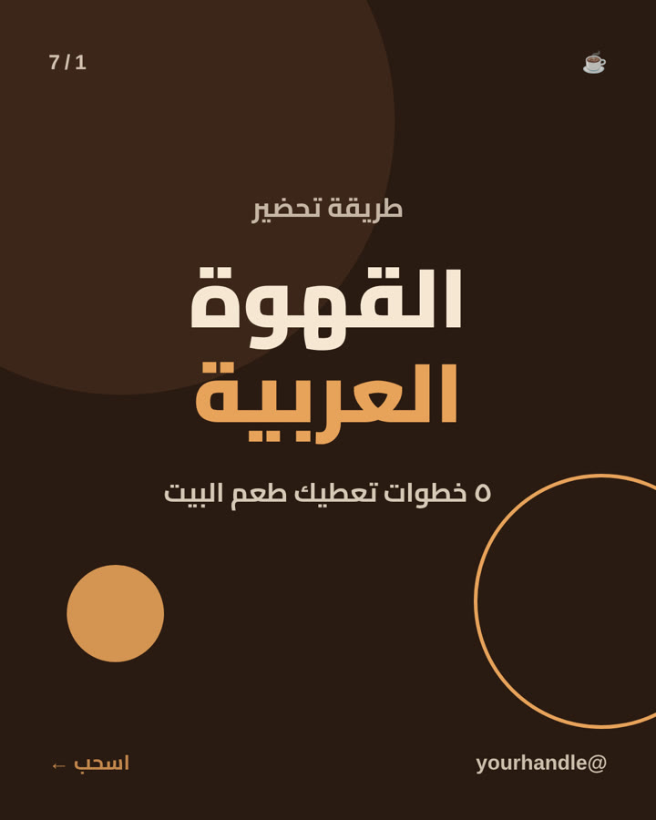
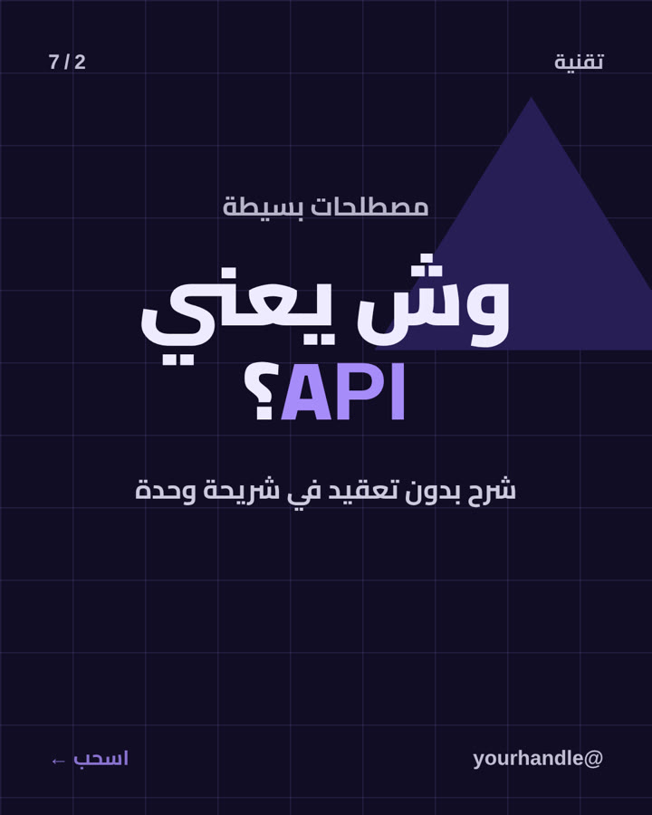
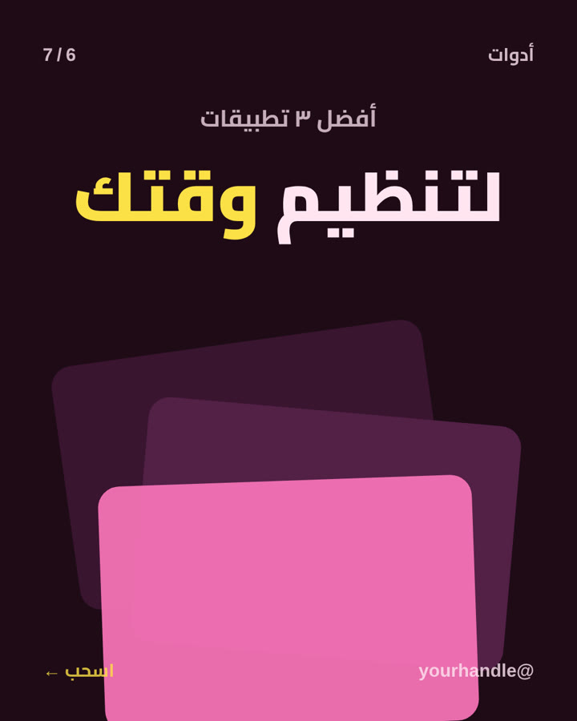
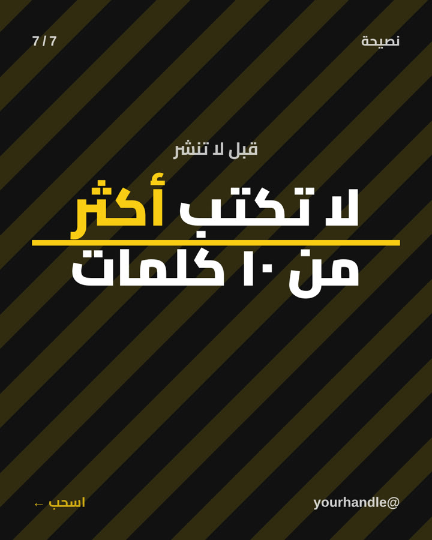
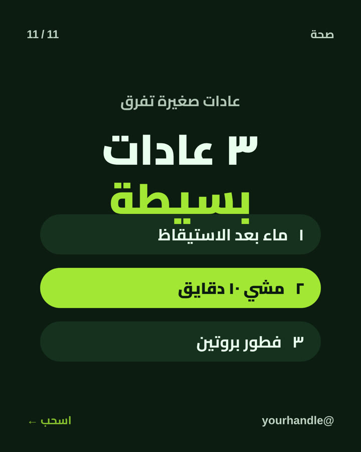
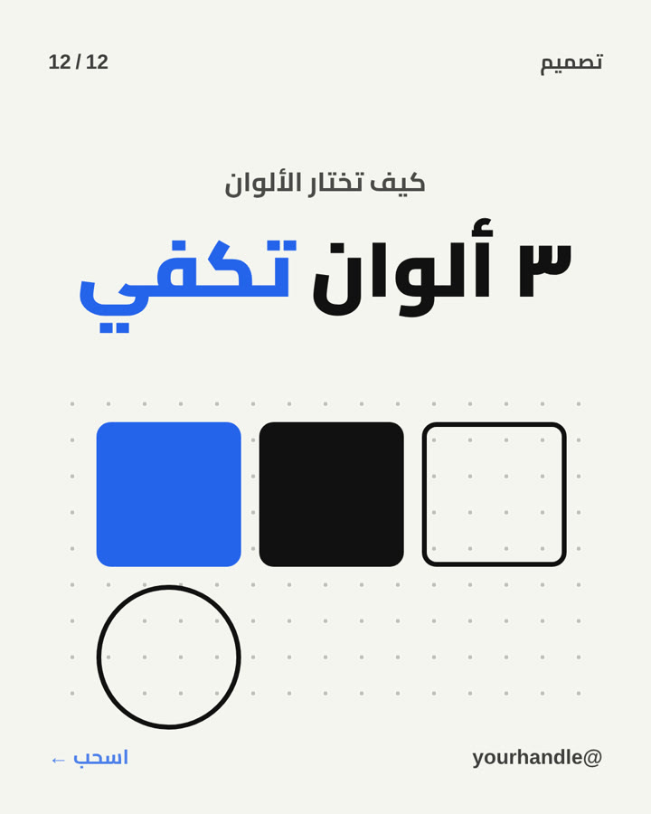

# Arabic Brand Carousel — مهارة كاروسيل عربي بهويتك على Claude

مهارة (Skill) لـ Claude تصمم لك كاروسيل انستقرام عربي كامل بهويتك، بدون فوتوشوب ولا كانفا.
تعطيها الموضوع، وهي تحلله وتسألك عن شعارك وألوانك، وتطلع لك الشرائح صور PNG جاهزة للنشر (1080×1350).

<p align="center">
  
  
</p>

## طريقة التركيب

**في تطبيق Claude (claude.ai):**
1. نزّل مجلد `arabic-brand-carousel` كملف ZIP (زر **Code ← Download ZIP**، وبعدين اضغط مجلد `arabic-brand-carousel` لحاله).
2. روح **Settings ← Capabilities ← Skills** واضغط **Upload skill** وارفع الملف.

**في Claude Code:**
```bash
git clone https://github.com/saoudphotos/arabic-brand-carousel.git
cp -r arabic-brand-carousel/arabic-brand-carousel ~/.claude/skills/
```

## الاستخدام
اكتب لـ Claude: «سو لي كاروسيل عن …» وخله يكمل.

---
صنعها [@saoudalajme](https://instagram.com/saoudalajme)
